---
author:
  name: Максимов Михаил Павлович
  group: НФИбд-02-26
  email: 1132260174@rudn.ru
  affiliation:
    - name: Российский университет дружбы народов
      country: Российская Федерация
      city: Москва
      address: ул. Миклухо-Маклая, д. 6
title: "Отчёт по лабораторной работе № 2"
---

# Цель работы

Целью работы является изучение идеологии и применения средств контроля версий, приобретение практических навыков по работе с системой контроля версий Git.

# Задание

На основе методических указаний провести работу с базовыми командами системы контроля версий Git, выучить применение команд для разных случаев использования, настроить GitHub.

# Выполнение лабораторной работы

## Техническое обеспечение

Лабораторная работа была выполнена на домашнем ПК под управлением операционной системы Fedora Linux 43 (Workstation Edition).

## Базовая настройка Git

Сначала я настраиваю Git: открываю терминал и ввожу необходимые команды.

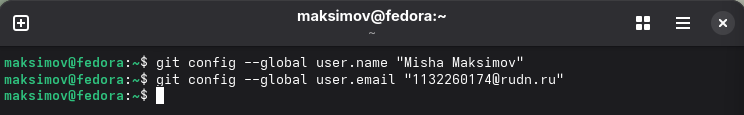{#fig-001 width=80%}

Далее я настраиваю параметры кодировки UTF-8, имя начальной ветки, а также параметры autocrlf и safecrlf.

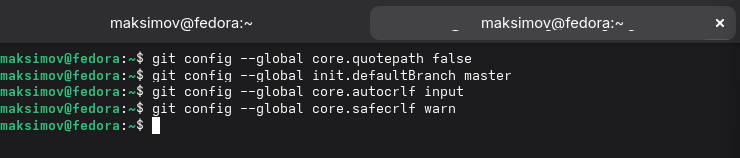{#fig-002 width=80%}

Затем я создаю пару SSH-ключей для подключения к платформе GitHub.

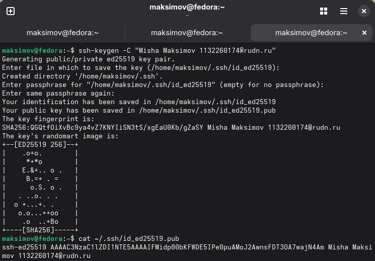{#fig-003 width=80%}

Затем я вхожу в аккаунт GitHub, открываю его настройки и добавляю открытый SSH-ключ в соответствующее поле.

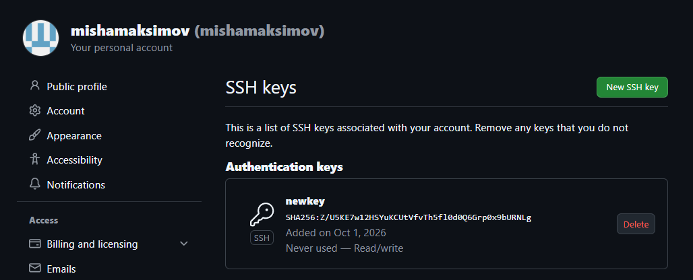{#fig-004 width=80%}

## Создание рабочего пространства и репозитория курса на основе шаблона.

Я создаю директорию для определенной структурной иерархии.

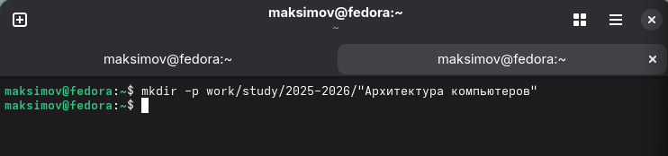{#fig-005 width=80%}

## Создание репозитория курса на основе готового шаблона.

Создаю репозиторий на основе имеющегося шаблона (Рисунок 6) с помощью соответствующей функции на GitHub.

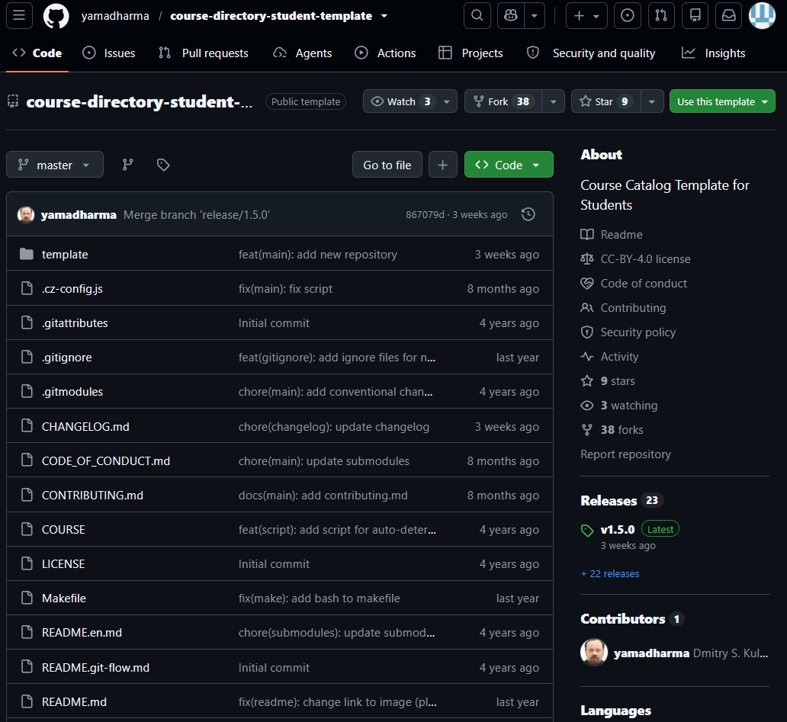{#fig-006 width=80%}

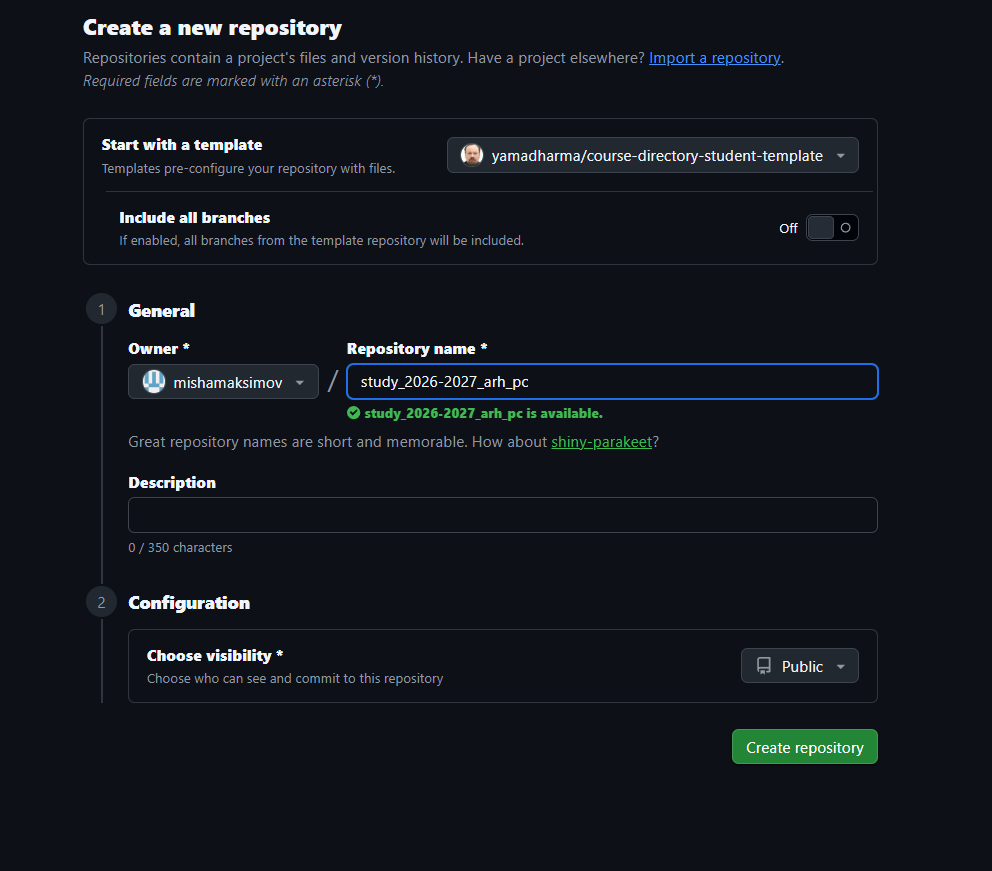{#fig-007 width=80%}

Затем я клонирую созданный по шаблону репозиторий на свой компьютер: копирую ссылку для клонирования в интерфейсе GitHub (Рисунок 8) и выполняю в терминале команду git clone. (Рисунок 9)

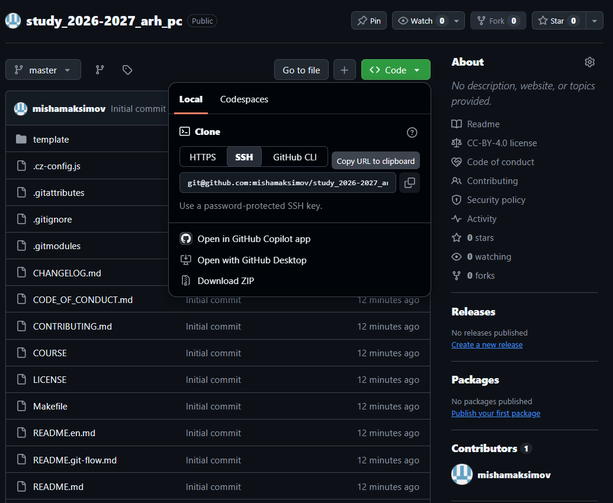{#fig-008 width=80%}

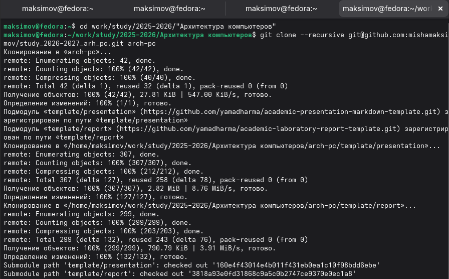{#fig-009 width=80%}

## Настройка каталога курса.

В каталоге курса удаляю ненужные файлы и создаю необходимые папки. (Рисунок 10)

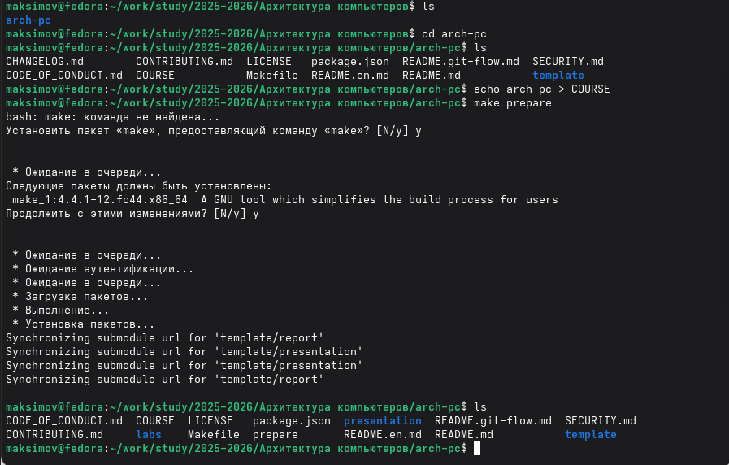{#fig-010 width=80%}

Делаю снимок сделанных изменений и push’y их на свой репозиторий в GitHub. (Рисунок 11 Рисунок 12)

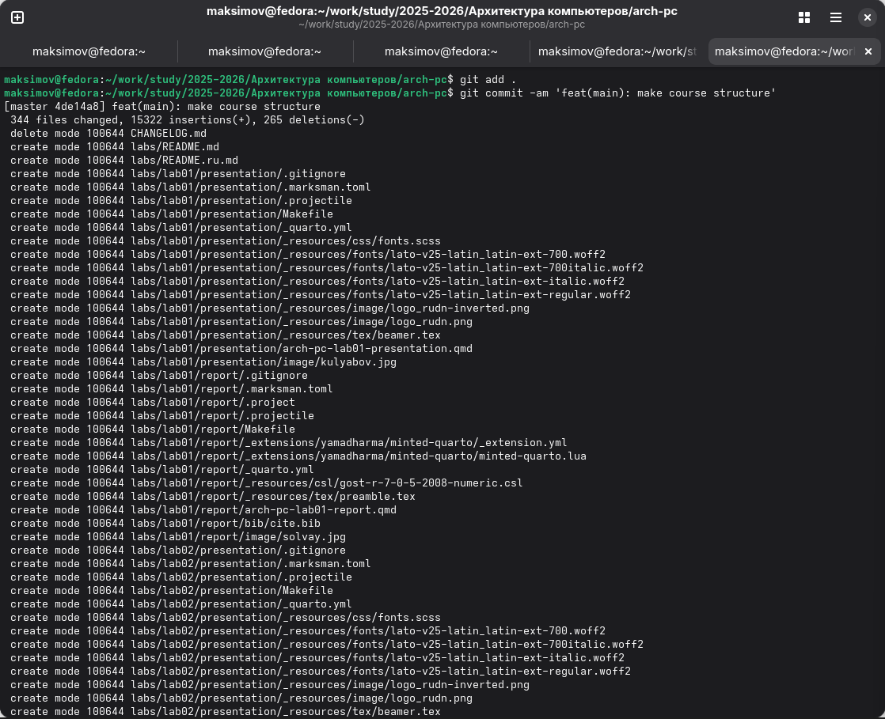{#fig-011 width=80%}

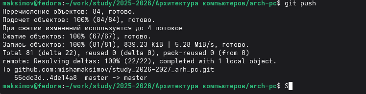{#fig-012 width=80%}

# Задания для самостоятельной работы.

Отправляю предыдущий отчет по лабораторный работе на свой удаленный репозиторий в GitHub (Рисунок 13)

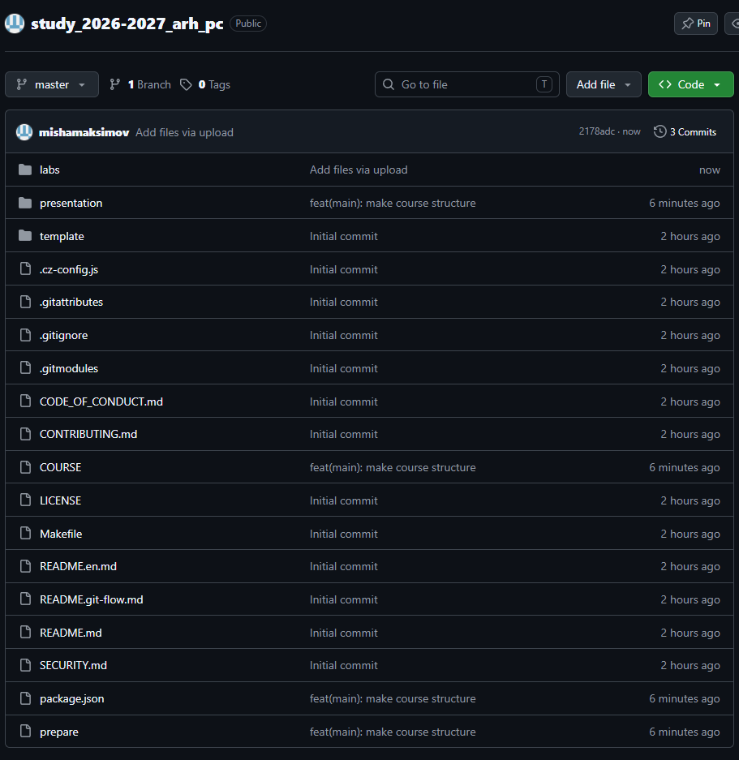{#fig-013 width=80%}

# Выводы

При выполнении лабораторной работы я изучил идеологию и применение средств контроля версий, а также приобрел практические навыки работы с системой Git.

# Список литературы

1. Основные Git команды: <https://git-scm.com/book/ru/v2/%D0%9F%D1%80%D0%B8%D0%BB%D0%BE%D0%B6%D0%B5%D0%BD%D0%B8%D0%B5-C:-%D0%9A%D0%BE%D0%BC%D0%B0%D0%BD%D0%B4%D1%8B-Git-%D0%9E%D1%81%D0%BD%D0%BE%D0%B2%D0%BD%D1%8B%D0%B5-%D0%BA%D0%BE%D0%BC%D0%B0%D0%BD%D0%B4%D1%8B>

2. GitHub Docs. Подключение к GitHub с помощью SSH: <https://docs.github.com/ru/authentication/connecting-to-github-with-ssh>