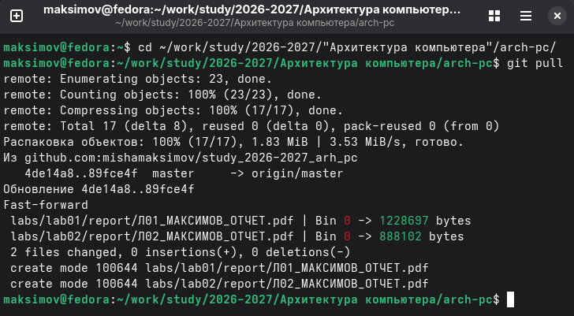
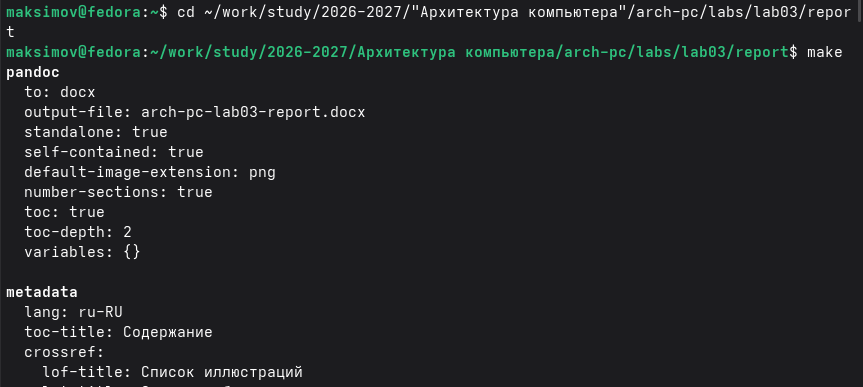
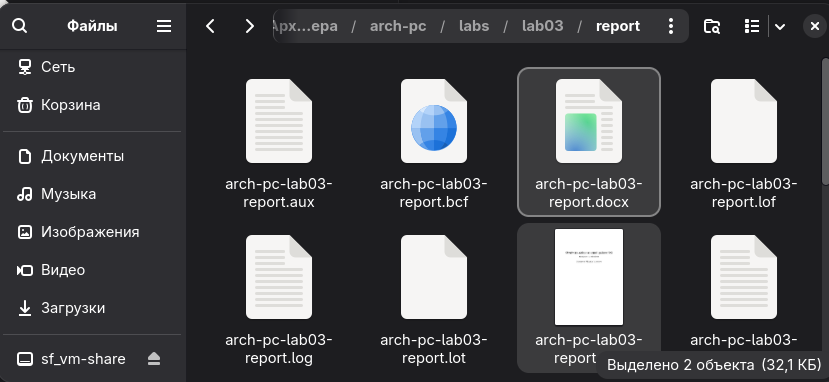
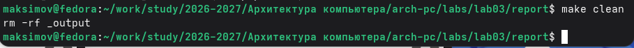
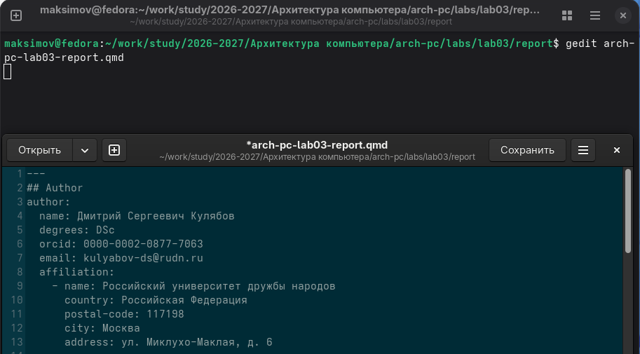
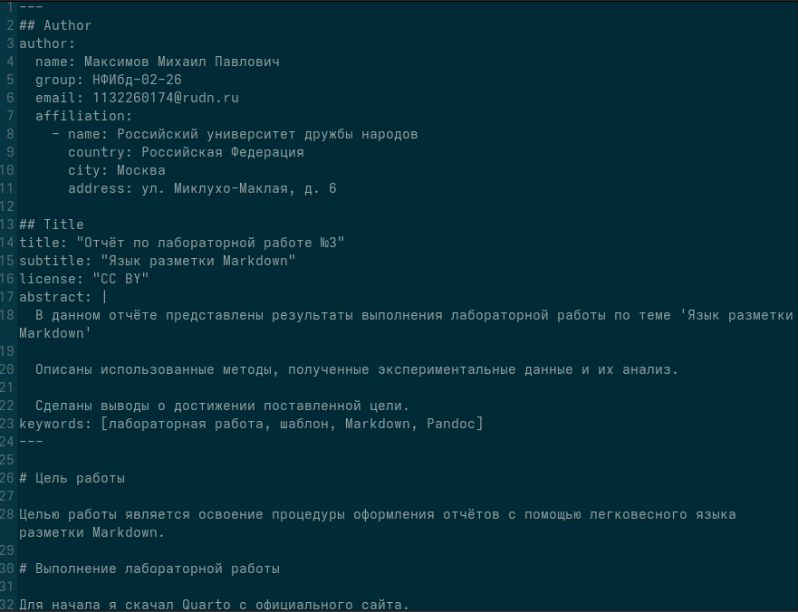
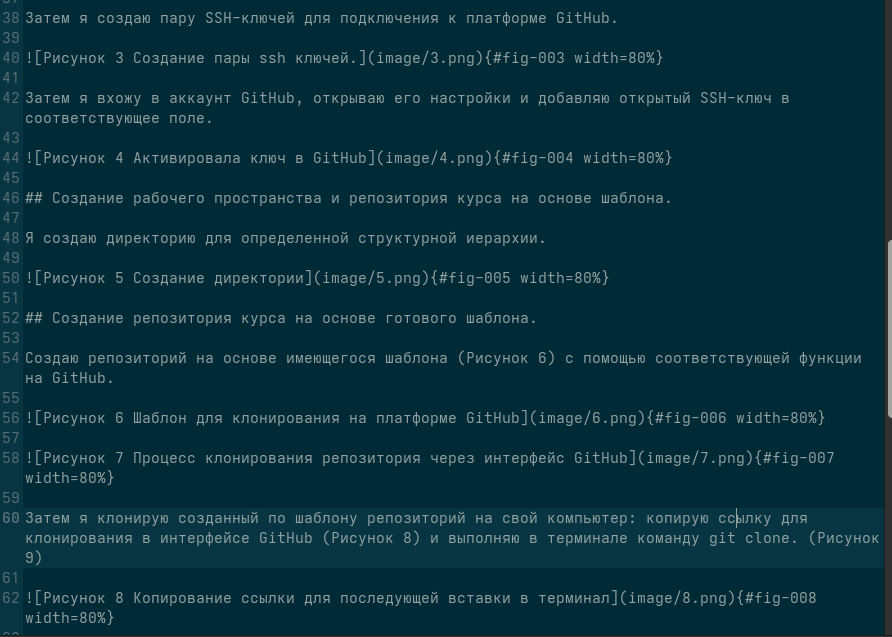

---
## Author
author:
  name: Максимов Михаил Павлович
  group: НФИбд-02-26
  email: 1132260174@rudn.ru
  affiliation:
    - name: Российский университет дружбы народов
      country: Российская Федерация
      city: Москва
      address: ул. Миклухо-Маклая, д. 6

## Title
title: "Отчёт по лабораторной работе №3"
subtitle: "Язык разметки Markdown"
license: "CC BY"
abstract: |
  В данном отчёте представлены результаты выполнения лабораторной работы по теме 'Язык разметки Markdown'

  Описаны использованные методы, полученные экспериментальные данные и их анализ.

  Сделаны выводы о достижении поставленной цели.
keywords: [лабораторная работа, шаблон, Markdown, Pandoc]
---

# Цель работы

Целью работы является освоение процедуры оформления отчётов с помощью легковесного языка разметки Markdown.

# Выполнение лабораторной работы

Для начала я скачал Quarto с официального сайта.

Затем приступил к выполнению лабораторной работы: открыл терминал, перешёл в каталог курса и обновил локальный репозиторий.

{#fig-001 width=80%}

Далее перешёл в labs/lab03/report и написал команду make, чтобы проверить компиляцию шаблона

{#fig-002 wight=80%}

Файлы созданы успешно

{#fig-003 wight=80%}

Удаляю эти файлы при помощи команды make clean

{#fig-004 wight=80%}

Затем я открыл файл arch-pc-lab03-report в текстовом редакторе gedit

{#fig-005 wight=80%}

Далее по шаблону создаю отчёт по лабораторной работе № 3 и с помощью команды make формирую файлы .pgf и .docx с собственным содержимым.

{#fig-006 wight=80%}

В завершение я добавил файлы в GitHub с помощью команд:

git add .
git commit -am "feat(main): add files lab-3"
git push

# Задания для самостоятельной работы

Полностью переделал лабораторную работу № 2 в Markdown и загрузил три файла (.qmd, .docx, .pdf) в репозиторий на GitHub.

{#fig-007 wight=80%}

# Вывод

Я освоил оформление отчётов с помощью легковесного языка разметки Markdown.
